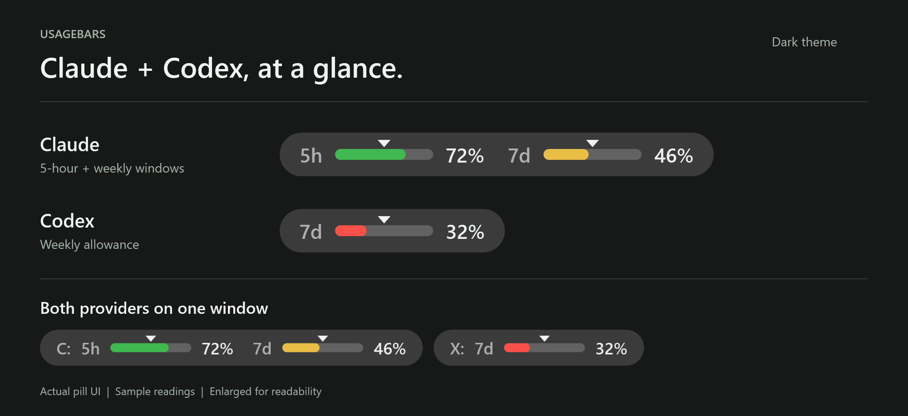
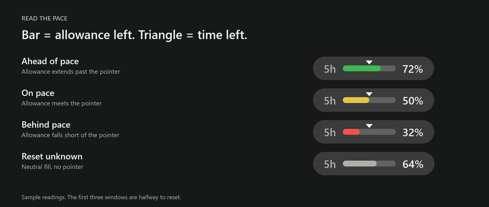

<h1 align="center">UsageBars</h1>

<p align="center">
  <strong>Your Claude and Codex allowance, right where you work.</strong><br>
  Small, click-through usage pills for your desktop apps, terminals, and IDEs.
</p>

<p align="center">
  <strong>Windows 10 / 11</strong> &middot; Portable executable &middot; No runtime install &middot; Light and dark themes
</p>

<p align="center">
  <a href="#get-started">Get started</a> &middot;
  <a href="#read-the-pills">Read the pills</a> &middot;
  <a href="#choose-your-windows">Choose your windows</a> &middot;
  <a href="#configuration">Configuration</a> &middot;
  <a href="#build-from-source">Build from source</a>
</p>

<picture>
  <source media="(prefers-color-scheme: dark)" srcset="docs/images/usage-pills-dark.png">
  <source media="(prefers-color-scheme: light)" srcset="docs/images/usage-pills-light.png">
  
</picture>

<p align="center">
  <sub>Rendered from the actual UsageBars pill UI with illustrative sample data. Enlarged for readability.</sub><br>
  <a href="docs/images/usage-pills-dark.png">View dark theme</a> &middot;
  <a href="docs/images/usage-pills-light.png">View light theme</a>
</p>

UsageBars puts your **remaining allowance** on the windows you already use.
Each provider gets its own pill. When both share a window, Claude sits on the left and Codex on the right.

| At a glance | What you get |
|---|---|
| **Allowance left** | Separate Claude and Codex readings, with the usage windows or credit/spend meters your source reports. |
| **Time until reset** | A moving triangle and pace colors compare remaining allowance with remaining time. Hover for reset details and reading age. |
| **Your choice of windows** | Built-in desktop, terminal, Rider, and VS Code targets. Add other apps with a window picker and live preview. |
| **Out of your way** | Click-through pills that do not take focus or appear in Alt+Tab. They follow window movement, DPI, and the Windows app theme. |
| **Your existing sign-ins** | Reads Claude Desktop history or Claude Code's usage screen, and Codex's app-server. No separate API-key setup. |

## Read the pills

**The number is what is left, not what you have used.** A `72%` bar means 72% of that allowance remains.



| Pill state | Meaning |
|---|---|
| **Green** | Allowance extends past the triangle. You have used less than the elapsed share of the window. |
| **Yellow** | Allowance is close to the triangle. Consumption is roughly on pace with the window. |
| **Red** | Allowance falls short of the triangle. You have used more than the elapsed share of the window. |
| **Neutral, no triangle** | The source has not supplied enough timing information to compare pace. |
| **Dimmed** | The reading is stale, or there is no usable value yet. |
| **`--`** | No source has produced a value for that bar. |
| **Amber `!`** | The provider CLI is missing. Click the icon to open its installation documentation. |

The triangle moves from right to left as reset approaches. Halfway through a five-hour window, it sits at 50%.
Pace colors need both a reset deadline and a window duration; a credit/spend meter may remain neutral even with a known expiry.

The fill blends smoothly: yellow within two percentage points of the triangle, reaching full red or green at 15 points away.
The pointer refreshes every five seconds, independently of new usage readings.
Burn-rate estimates do not control these colors, and a passed deadline stays at the left edge until a new one arrives.

When two pills share a host, `C:` identifies Claude and `X:` identifies Codex.
A pill alone on a window needs no provider marker.
Except for the clickable install icon, clicks and drags pass through to the host.

## Get started

Run the published executable on **Windows 10 or Windows 11, x64**.
You do not need an installed .NET runtime, a separate VC++ redistributable, or administrator rights.
To make your own executable, see [Build from source](#build-from-source).

1. Put `UsageBars.exe` in a writable folder.
   Keep an optional `UsageBars.config.json` beside it.
2. Sign in to the provider apps you want to monitor.
   Claude Desktop history can work without the Claude Code CLI.
   The Claude fallback needs a signed-in Claude Code CLI; Codex needs a usable signed-in Codex app-server.
3. Start the executable:

   ```powershell
   .\UsageBars.exe
   ```

   From this repository after publishing, run `.\dist\UsageBars.exe` instead.
4. Open a supported app, terminal, or IDE.
   The default targets attach pills automatically when their saved rules match.

UsageBars lives in the notification area. **Left-click the tray icon to refresh**; right-click it for targets, diagnostics, startup, and Exit.
The Claude CLI fallback starts a hidden interactive session, so its first reading takes longer than a local-file read.

### Start with Windows

Enable **Start with Windows** in the tray menu.
This registers the current executable in `HKCU\Software\Microsoft\Windows\CurrentVersion\Run\UsageBars`.
Clearing the option removes that current-user entry.

The check mark means this copy is registered.
After you move the executable, a registration pointing to a missing copy is repaired on launch.
A registration pointing to another existing copy is reported but not silently replaced.
Click the unticked item to register the copy you are running.

## Choose your windows

Each matching window gets its own pill. Multiple windows can show the same account allowance at once.

| Default target | Starting position | Activation |
|---|---|---|
| Claude Desktop | Top center | While its matching window is open |
| Codex / ChatGPT desktop | Top center | While its matching window is open |
| Supported terminals | Top right, clear of window controls | When the target's selected activity processes are running |
| Rider and VS Code main frames | Bottom center, in the status bar | Both providers while the IDE is open |
| Other seeded editors, including Cursor, Windsurf, VSCodium, Visual Studio, and other JetBrains IDEs | Top right | Both providers when either `claude` or `codex` is running under the window owner |

These are **first-run defaults**, not fixed restrictions. Saved targets own their providers, activation rules, and placement.

### Add or edit a target

1. Open **Targets > Manage targets...** from the tray menu.
2. Choose **Add**, then click the window you want to capture.
   The manager hides during capture; press Escape or right-click to cancel.
3. Choose Claude, Codex, or both.
   Review the window conditions and any overlapping saved rules before creating a duplicate.
4. Set activity to **Always while the window is open** or **When any selected process is running**.
5. Choose **Top center**, **Top right**, or **Bottom center**, then adjust the X/Y offsets.
   The actual pills preview your changes before you save.
6. Choose **Save changes** to persist the target, or **Cancel changes** to discard the draft.

The manager is one reusable, modeless window.
Editing a saved rule previews it on every currently matching window.
If the draft would be inactive, the preview stays available for positioning and explains the failed condition.
Enable/Disable and confirmed Delete take effect immediately; they are not pending draft edits.

<details>
<summary>Matching rules, process activity, and live-preview details</summary>

- **Window conditions combine with AND.** A rule can check the owning process, window class,
  resizable frame, and an optional title condition.
- **Activity processes combine with OR.** One selected process name is enough to activate the target.
  When active, the target shows every checked provider that is also globally enabled.
- **Literal and Prefix titles are case-insensitive.** Regex is case-sensitive unless you include `(?i)`;
  matching has a 100 ms timeout. **Use current title** copies the title and selects Literal mode.
- **Process filters persist by executable name, not PID.** Select names from the captured process tree,
  or add a name that is not currently running. Use the refresh button to update the tree without losing selections.
- **Preview follows the draft.** Provider, title, activity, enabled state, placement, anchor, offsets,
  resizable-frame condition, and IDE status-bar height update the preview.
  A draft with no inferred provider uses a neutral Preview pill.
- **Position belongs to the target.** Arrow buttons move four logical pixels; exact positive or negative
  offsets and **Reset offset** are also available. There is no global Position submenu.
- **One winner per provider and window.** More specific rules win; equal-specificity ties go to the
  most recently edited rule. Claude and Codex can each win once on the same window.

Targets are stored in `UsageBars.data\targets.json`, currently version 3.
Saved rules use durable process/class/title conditions, not transient window handles or PIDs.
Older files migrate in memory and save in the current format on the next successful change.

</details>

> **Windows Terminal limitation:** sibling windows, tabs, and panes can share an owner process.
> A matching descendant process may therefore activate several otherwise-matching windows.
> UsageBars does not claim reliable process-to-tab attribution. Add a title condition when the visible title can narrow the match.

### Visibility and stacking

Pills follow moves, resizes, maximize, and monitor changes without taking focus.
By default they remain visible when their host is not focused, but hide with minimized or closed hosts.
Covered pills stay with their host rather than floating over unrelated apps.
A title-bar strip too narrow for the pill hides it instead of covering the window controls.

`PlacementMode: "auto"` prefers Windows ownership, then a position directly above the host, then a topmost fallback.
The fallback performs explicit coverage checks.
`HideWhenCovered` controls those checks; turning it off does not change an owned pill into a universally topmost window.
Set `AlwaysOn: false` to show pills only while their own host is focused.

## Where the readings come from

UsageBars reuses provider apps and their existing authentication.
You do not paste account cookies, session tokens, or API keys into UsageBars.
The values describe provider-reported account allowances, not usage attributable to the individual window carrying a pill.

### Claude

**Fresh Desktop history is preferred.** UsageBars looks for `plan-usage-history.json` in these locations:

- `%LOCALAPPDATA%\Packages\Claude_*\LocalCache\Roaming\Claude\plan-usage-history.json`
- `%APPDATA%\Claude\plan-usage-history.json`

UsageBars tries candidates from newest to oldest.
The reader accepts schema versions 1 and 2, caps files at 1 MiB, and retries torn writes without blocking Claude's own writer.
Where history reaches the start of a usage window, observed resets and resumed usage let UsageBars derive its deadline.
Insufficient history leaves the reset unknown.

**Claude Code's `/usage` screen is the fallback.** When the file has no values or becomes stale,
UsageBars drives the signed-in CLI in a hidden pseudo-console.
It understands session and weekly windows, named model windows, and credit/spend meters.
The Fable window stays available in tray percentages and diagnostics but is omitted from pills and pill hover.

A successful newer scrape can replace stale file data.
If no valid newer scrape exists, the last usable file reading remains available and may appear dimmed.
The default scrape interval is 15 minutes, with backoff after repeated failures.
Set `UseClaudeCodeFallback: false` to use only Desktop history and never launch this fallback.

Single-meter scrape readings can be restored from persisted history.
Multi-window CLI readings are retained in memory rather than persisted through that cache.
Reset text is parsed when possible; missing or unparseable timing stays unknown.

### Codex

UsageBars starts `codex app-server` as a hidden child process and communicates over stdio using JSON-RPC:

- `account/rateLimits/read` requests the current allowance.
- `account/rateLimits/updated` supplies pushed updates.
- Polling, every two minutes by default, provides a safety net.

Discovery considers an explicit override, the running ChatGPT bundle, a running Codex process, and `PATH`.
Store-package discovery is used when earlier discovery finds no candidate.
Both `app-server --stdio` and bare `app-server` are supported.
The monitor reconnects with backoff and keeps the last successful snapshot across connection failures.

Primary and secondary account windows become bars, along with a spend allowance when reported.
Reset deadlines and durations come from the response when present; they are not guaranteed fields.
Per-model buckets and reset-credit counts remain metadata, not buttons for redeeming allowance.
UsageBars has no request-credit or request-reset action.

## Configuration

Edit `UsageBars.config.json` beside the executable, then restart UsageBars.
The file is optional; every setting has a default.
The [commented default configuration](UsageBars.config.default.json) is a starting point, and `build.ps1` never overwrites an existing copy.

If no usable adjacent config exists, UsageBars also checks `config.json` in its data directory.
Comments and trailing commas are accepted. Invalid numeric values are clamped; **Copy diagnostics** lists the adjustments.

| Setting | Default | Purpose |
|---|---|---|
| `EnableClaude` | `true` | Show Claude on enabled targets. |
| `EnableCodex` | `true` | Show Codex on enabled targets. |
| `CodexRefreshMinutes` | `2` | App-server polling interval, in addition to pushed updates. |
| `UseClaudeCodeFallback` | `true` | Allow the hidden Claude Code `/usage` fallback. |
| `ScrapeIntervalMinutes` | `15` | Claude CLI refresh interval; repeated failures back off. |
| `FileStaleMinutes` | `15` | Age at which a Desktop-history sample is stale. |
| `ReadingStaleHours` | `2` | Age at which a CLI or app-server reading is stale. |
| `AlwaysOn` | `true` | Keep pills visible when their hosts are not focused. |
| `PlacementMode` | `"auto"` | Attachment strategy: `auto`, `zorder`, or `topmost`. This is not the target's anchor. |
| `HideWhenCovered` | `true` | Hide covered pills when explicit topmost-fallback checks apply. |
| `TitleBarHeight` | `40` | Fallback title-bar strip height, in logical pixels. |
| `RightReservePx` | `160` | Title-bar space kept clear for window controls. |
| `WriteDiagnosticsLog` | `true` | Write the regular rotating event log. Does not disable the lifecycle journal. |

<details>
<summary>First-run target settings, capture hints, and diagnostic estimates</summary>

**Seed settings apply only before `targets.json` exists.**
After that, use the target manager; changing these settings does not rewrite, re-enable, or recreate saved targets.

| Setting | Default | Purpose |
|---|---|---|
| `AttachToClaudeCodeTerminals` | `true` | Enable the initial Claude terminal targets. |
| `AttachToCodexTerminals` | `true` | Enable the initial Codex terminal targets. |
| `AlwaysShowOnIdes` | `true` | Seed Rider/VS Code with always-open rather than session-required activation. |

`TerminalTitlePattern` and `CodexTitlePattern` are **capture-time hints** when Add infers a provider.
They are not saved title rules or live activity controls.
See the default config for their full regular expressions.

**Burn-rate estimates are diagnostic information, not pill-color thresholds.**

| Setting | Default | Purpose |
|---|---|---|
| `WarnHoursToEmpty` | `2` | Low-usage estimate horizon, in hours. |
| `VelocityPaddingFactor` | `1.25` | Safety multiplier on measured consumption. |
| `LowThresholdPct` | `10` | Remaining-allowance floor for the diagnostic warning. |
| `VelocityWindowHours` | `3` | History window for measuring consumption. |
| `MinVelocitySamples` | `3` | Samples needed before an estimate is trusted. |
| `MinVelocitySpanMinutes` | `20` | Minimum elapsed time covered by those samples. |
| `UseConfiguredResetDay` | `false` | Allow a configured reset-day fallback when no measured reset is available. |
| `ResetDayOfWeek` | `"Friday"` | Fallback weekday, labeled as not measured. |
| `ResetHour` | `0` | Local fallback hour. Does not supply a measured reset pointer. |

Legacy global placement keys, credit-action URLs, and absolute color thresholds are ignored.
Per-target placement and activation live in `targets.json`.

</details>

Environment overrides are available for support and testing:

| Variable | Effect |
|---|---|
| `USAGEBARS_FILE` | Use one specific Claude history JSON file. |
| `USAGEBARS_CLAUDE` | Use a specific Claude CLI executable. |
| `USAGEBARS_CODEX` | Use a specific Codex CLI executable. |
| `USAGEBARS_DATA` | Override the data-directory location. |

## Portable files and privacy

UsageBars keeps application state in **`UsageBars.data` beside the executable** when that directory is writable.
Otherwise it falls back to `%LOCALAPPDATA%\UsageBars`. `USAGEBARS_DATA` takes priority over both locations.

```text
UsageBars.exe
UsageBars.config.json                       optional personal settings
UsageBars.data/
  targets.json                             saved window rules
  usage-history.json                       single-meter history
  bar-history.json                         accumulated Codex readings
  winpty/                                  extracted pseudo-console binaries
  probe/                                   working directory for the Claude fallback
  diagnostics/
    usagebars.jsonl                        rotating event log
    lifecycle.jsonl                        startup, activity, and exit journal
```

The published executable includes the .NET runtime and its native dependencies.
Windows still extracts single-file native libraries into its `%TEMP%\.net\UsageBars` cache.
The winpty binaries are embedded and extracted to the data directory on first use.
Enabling startup also writes the current-user Run entry; the provider CLIs retain their own normal authentication and state.

Diagnostics redact common credential patterns, email addresses, and the current user's profile path.
**Review diagnostics before sharing them:** custom target names, window information, and process details can still be private.
Redaction is not a guarantee that every possible secret format is recognized.

The repository ignores local runtime data, personal config, environment files, and common private-key formats.
The screenshots in this README contain sample readings, not account data.

## Diagnostics and troubleshooting

The tray menu contains **Refresh now**, **Targets**, **Start with Windows**, **Copy diagnostics**, **Open diagnostics folder**, and **Exit**.
Its hover text shows current percentages; pill hover shows reset details and reading age.

Use **Copy diagnostics** to inspect sources, candidate paths, CLI discovery, target matching, config adjustments,
Codex metadata, and recent events. **Open diagnostics folder** opens the logs.
Rates and estimated exhaustion times appear in diagnostics when enough history exists.

| Symptom | What to check |
|---|---|
| Bars show `--` | Confirm the provider is installed and signed in. Check source/CLI errors in Copy diagnostics. |
| Bars are dimmed | Check reading age, whether Desktop history is still updating, and whether the fallback or app-server can refresh. |
| A pill is missing | Check enabled targets/providers, activity/title rules, host minimization or coverage, available space, and `AlwaysOn`. |
| A bar has no triangle | Check whether both its reset deadline and window duration are known. Neutral does not mean the usage value is missing. |
| Refresh leaves percentages unchanged | Refresh does not refill allowance. An unchanged provider reading correctly leaves the bar unchanged. |
| A pill appears on several Terminal windows | Review shared-owner activity rules and add a title condition where possible. |

### Event and lifecycle logs

The regular `diagnostics\usagebars.jsonl` log records state changes rather than every poll.
It rotates at 1 MiB with three generations. `WriteDiagnosticsLog: false` disables this log.

The separate `diagnostics\lifecycle.jsonl` journal records startup, pill activity, tray Exit requests,
Windows session ending, unhandled exceptions, and exit events.
It includes a run ID, process ID, pill count, and last pill activity, plus a heartbeat every 30 seconds.
Writes are synchronous and best-effort; the file rotates at 1 MiB and keeps one predecessor, `lifecycle.jsonl.1`.
**This journal remains enabled when `WriteDiagnosticsLog` is false.**

`previous-run-incomplete` means the previous run left no recognized final exit record.
A forced kill, power loss, or native crash can prevent final logging; the journal cannot identify who terminated the process.
Unhandled exceptions are recorded without suppressing them.

### Recover a damaged target file

If `targets.json` is partly invalid, UsageBars keeps its valid entries in memory and reports the rejected entries in diagnostics.
If the whole document cannot load, including malformed JSON or an unsupported version, UsageBars uses first-run defaults in memory instead.
**Those defaults can reactivate targets you previously disabled or removed.** The original file is not immediately overwritten.

On the next successful target change, UsageBars preserves the old file as `targets.corrupt.<timestamp>.json`
or `targets.invalid.<timestamp>.json` and writes a valid replacement atomically.

To seed a fresh set manually:

1. Exit UsageBars.
2. Copy the damaged file somewhere safe.
3. Rename or remove `targets.json`.
4. Restart UsageBars.
5. Use the manager to recreate the rules you want.

## Build from source

Build on Windows with **PowerShell 7** and a **.NET SDK that can target .NET 8 Windows Desktop**.
Initial restore needs access to the required packages or a populated local cache.

> **Running copies are stopped during publishing.** The script matches executable paths in this checkout's `dist`
> and staging directories, not every process named UsageBars. It relaunches a previously running copy unless you pass `-NoRelaunch`.

```powershell
pwsh -File .\build.ps1
```

Output is a self-contained `dist\UsageBars.exe` for `win-x64`.
The script supplies a commented config if none exists and preserves an existing personal config.

| Option | Effect |
|---|---|
| `-Run` | Start the published app even if it was not running before the build. |
| `-NoRelaunch` | Leave a previously running app stopped after publishing. |
| `-Runtime win-arm64` | Select an ARM64 publish target; see the native-binary caveat below. |

**ARM64 caveat:** publishing supports that runtime identifier, but the project embeds the same vendored winpty binaries for every target.
A successful ARM64 publish does not establish native compatibility of the Claude CLI fallback.
Compatible native binaries and a runtime check are needed before relying on that path.

### Run the tests

```powershell
dotnet test .\UsageBars.sln
```

Tests target `net8.0-windows` and use WPF/WinForms.
They require Windows and the corresponding desktop runtime, not an interactive desktop or provider sign-in.
Coverage includes parsers, reset timing and pace colors, pill rendering, target management, placement,
diagnostics/redaction, startup registration, and the lifecycle journal.

### Find the implementation

| Area | Files |
|---|---|
| Claude sources | `src/UsageSource.cs`, `src/ClaudeCodeUsage.cs`, `src/ClaudeCli.cs` |
| Codex connection and parsing | `src/CodexCli.cs`, `src/CodexAppServer.cs`, `src/CodexMonitor.cs`, `src/CodexUsage.cs` |
| Bars, reset timing, and estimates | `src/UsageModel.cs`, `src/ResetPace.cs`, `src/ResetEstimator.cs`, `src/UsageVelocity.cs`, `src/BarHistory.cs` |
| Pill drawing and host behavior | `src/OverlayView.cs`, `src/OverlayWindow.cs`, `src/ProviderPill.cs`, `src/HostWindow.cs`, `src/ZOrder.cs` |
| Saved targets and matching | `src/WindowTargets.cs`, `src/TargetDefaults.cs`, `src/TargetStore.cs`, `src/TargetResolver.cs` |
| Target capture, editing, and previews | `src/WindowPicker.cs`, `src/TargetManagerForm.cs`, `src/TargetEditorControl.cs`, `src/TargetPreviewSet.cs` |
| App lifecycle and tray | `src/Program.cs`, `src/OverlayController.cs`, `src/Tray.cs`, `src/StartupRegistration.cs` |
| State, settings, and logs | `src/AppPaths.cs`, `src/Config.cs`, `src/Diagnostics.cs`, `src/LifecycleLog.cs` |

The Claude fallback uses the vendored [winpty binaries](third_party/winpty/), covered by their [MIT license](third_party/winpty/LICENSE).
The standalone scripts under `tools/probe-usage.*` are development probes, not app runtime dependencies.
UsageBars itself does not use those scripts to decrypt browser cookies or call Claude's web usage API.
